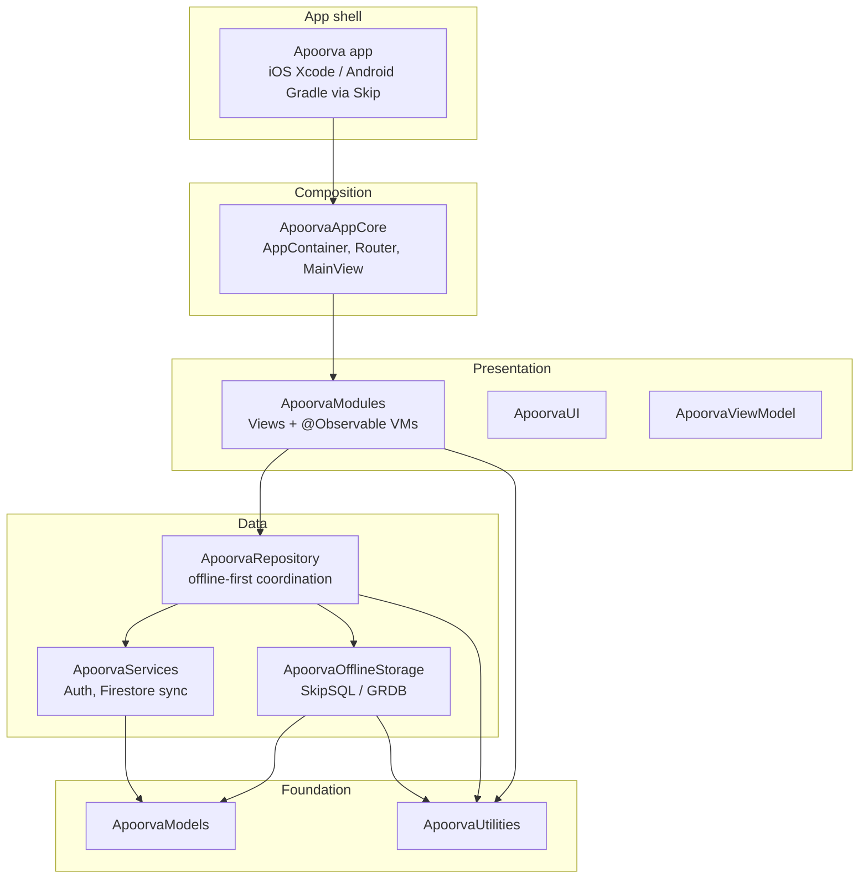
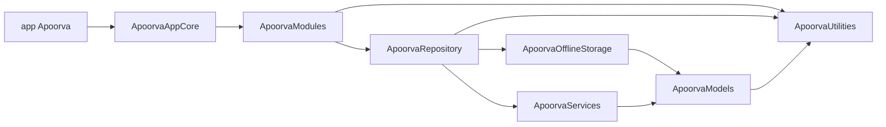
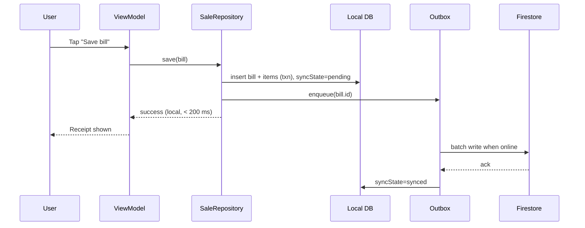
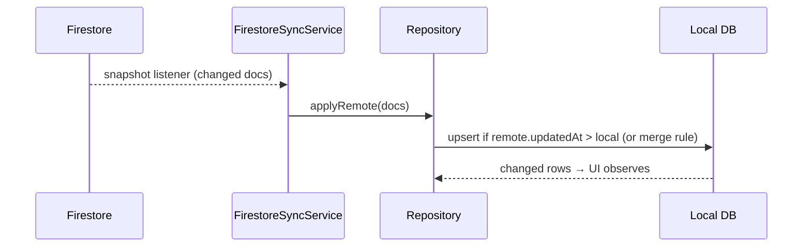
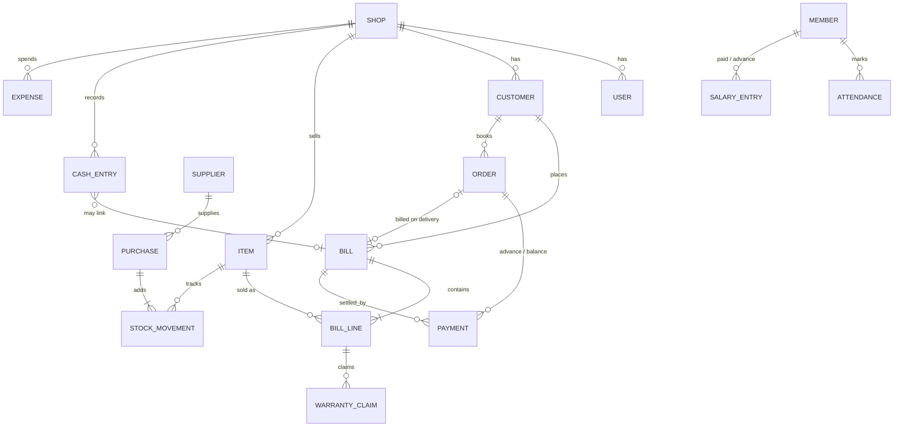
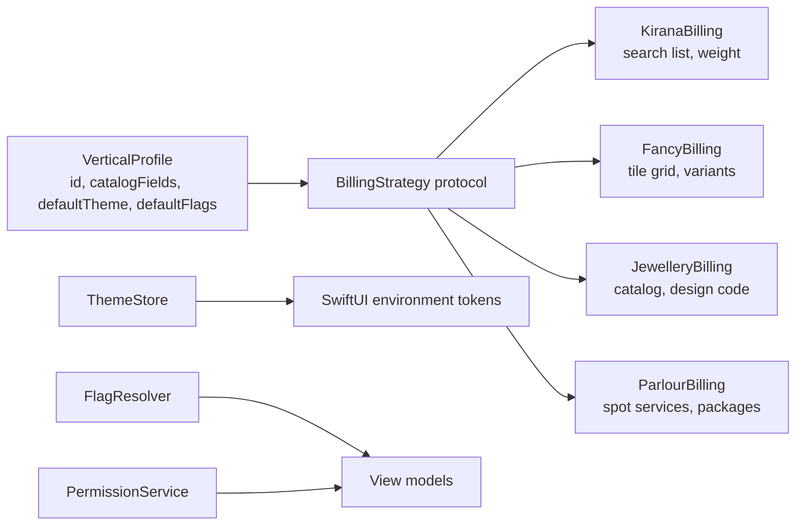

# 03 — Architecture & High-Level Design

## 1. Layers

## 2. Module dependency graph (from package manifests)

Rules:
- Views never touch storage or Firebase directly.
- Only `ApoorvaAppCore` knows concrete types; everything else depends on protocols.
- `ApoorvaUI` and `ApoorvaViewModel` are placeholders — fill when a second screen needs shared components.

## 3. Key flows

### 3.1 Create bill

### 3.2 Pull remote changes

### 3.3 Login and session
Firebase Auth → token with `shopId` custom claim → repository scoped to shop → local DB opened per shop (file name includes `shopId`).

## 4. Data model (ERD)

Item adds `prices` (retail, wholesale), `unit`, `packSize`, `warrantyValue`, `warrantyUnit` (days|months|years). Bill line stores `warrantyUntil` at sale time, so later changes to the item never change past warranties.

Every table carries: `id` (UUID), `shopId`, `createdAt`, `updatedAt`, `deviceId`, `syncState`, `isDeleted`.

## 5. Cross-cutting
- **IDs:** UUIDv4 generated on device (no server round trip).
- **Time:** store UTC; display in shop timezone.
- **Money:** integer minor units (paise). Never `Double`.
- **Errors:** typed `AppError` per layer, mapped to user message in VM.
- **Logging:** `os.Logger` on iOS, Logcat via Skip; forwarded to Crashlytics for errors.

## 6. Verticals, themes, flags (one app)

- `VerticalProfile` is data (synced from Firestore `verticals/{id}`). `BillingStrategy` is the only code per vertical: item picker view, line-item rules (weight, variant, done-by staff), receipt template. Adding handloom means one new strategy and one profile doc.
- Cart, checkout, payments, sync, ledger and analytics are shared and vertical-agnostic.
- `ThemeStore`, `FlagResolver` and `PermissionService` are built in `AppContainer` and injected. They have no globals.
- Placement: `ApoorvaUI` (ThemeStore, component kit, font loader, icon mapping Lucide → SF Symbols / Material Symbols), `ApoorvaModels` (VerticalProfile, FlagResolver, Permission, TaxPolicy), `ApoorvaModules` (Auth sign-in hub, Billing strategies incl. calculator, Orders, Suppliers & Purchases, Expenses, Staff, Warranty, Insights, Settings incl. Payments & Devices, Admin, Platform console, Developer settings). `AppEnvironment` (dev/stg/prod) is chosen at launch and passed to `AppContainer`, which builds Firebase and the local DB for that environment.

Additional entities: `ORG`, `STORE` (with `verticalId`), `MEMBER`, `ROLE`, `FLAG_OVERRIDE`, `THEME`, `AUDIT_EVENT`, `SERVICE`, `PACKAGE`, `PLAN_USAGE` (bills this month, grace used). See the ERD in [10](10-admin-and-multi-tenancy.md).

## 7. Decisions
| Decision | Choice | Why |
|----------|--------|-----|
| Source of truth | Local SQLite | Offline-first |
| Sync backend | Firestore | Already in use, real-time listeners |
| Storage backend | SkipSQL now, GRDB as iOS-only option | Shared code across iOS/Android |
| DI | Containers in AppCore | No singletons, testable |
| Multi-device conflicts | LWW per field + append-only money/stock | Simple and predictable |
