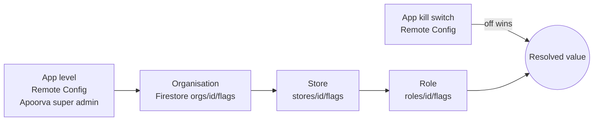

# 05 — Feature Flags & Remote Config

## Levels and resolution

Rules:
1. **App level decides availability.** If it is off, nobody gets the feature, whatever the org says. Admin UI shows it as "set by Apoorva" (locked).
2. **Org → Store → Role narrow it down.** A lower level can only turn a feature *off* or tune a value. It can never enable what a higher level disabled.
3. **Vertical defaults** seed org flags at onboarding (e.g. `appointments` on for parlour).
4. **User preferences** (theme, compact lists) are not flags. They live in Settings.

## Implementation
- `FeatureFlagService` protocol in `ApoorvaServices`, with a `FlagResolver` that is a pure function in `ApoorvaModels`, fully unit tested.
- Sources: Firebase Remote Config (app level, compiled defaults) plus Firestore docs for org/store/role, cached in SQLite so flags work offline.
- View models ask `flags.isOn(.returns)`. Views never read Remote Config directly.
- Kill switches are checked at the start of each operation, not cached for the session.
- Debug builds have a hidden override panel. It is stripped from release.

## Flag catalogue

| Key | Type | App default | Typical org/role use |
|-----|------|-------------|----------------------|
| `billing.credit_sales` | bool | on | Off for cashier role |
| `billing.returns` | bool | on | Managers only |
| `billing.discount_max_pct` | int | 100 | Cashier 10, manager 30 |
| `billing.hold_bills` | bool | on | — |
| `billing.split_payment` | bool | on | — |
| `printing.bluetooth` | bool | off | Per store with printer |
| `appointments` | bool | on | Parlour vertical only |
| `inventory.edit` | bool | on | Off for cashier/stylist |
| `insights.view` | bool | on | Owner/manager |
| `insights.export` | bool | off | Rollout |
| `loyalty` | bool | off | Not released (app locked) |
| `multi_store` | bool | off | Pro plan |
| `plan.staff_accounts` / `plan.reports_export` / `plan.packages` | bool | off | Turned on by Pro plan or trial |
| `tax.enabled` | derived | off | From org `taxMode`, not a flag. Listed here so it is not duplicated as one |
| `sync.batch_size` / `sync.interval_sec` | int | 50 / 30 | App only |
| `kill.sync_writes` | bool | off | Emergency, app only |
| `auth.phone_otp` | bool | on | App only. Sign-in hub hides it when off |
| `auth.email_password` | bool | on | App only. Covers email sign-in and registration |
| `auth.google` | bool | on | App only |
| `auth.apple` | bool | off | App only. Must be on for iOS release if Google is on |
| `auth.email_verification_required` | bool | on | App only. Verify before cloud sync |
| `auth.registrations_open` | bool | on | App only. Off pauses new sign-ups; existing users unaffected |
| `min_app_version` | string | 1.0.0 | Force-update gate |

## Governance
- Each flag has an owner, created date and expiry. Remove release flags within 2 cycles after 100%.
- Admin changes to flags are written to the audit log (see 10).
- Flag values are attached as Crashlytics custom keys.

## Rollout
Internal shops → 10% of orgs (hash of orgId) → 100%. Roll back by flipping the app-level value, which takes effect on the next fetch or on foreground.
