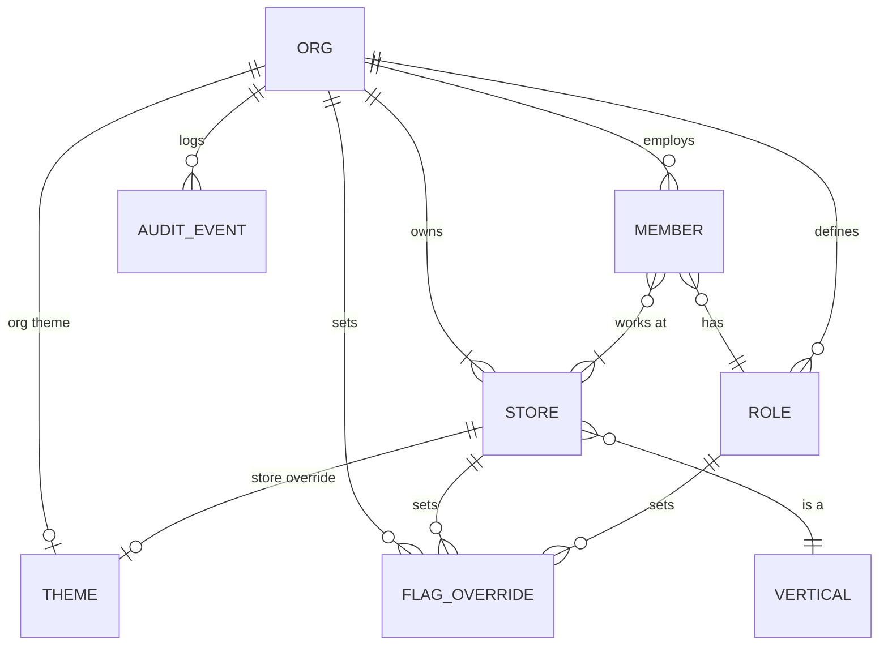

# 10 — Admin & Multi-tenancy

## Tenancy model

- **Org** = business account (one owner, many stores). **Store** has one vertical. One org can mix verticals: a parlour and a fancy store under one owner.
- Firestore paths: `orgs/{orgId}`, `orgs/{orgId}/stores/{storeId}`, `.../members`, `.../roles`, `.../flags`, `.../audit`.
- Custom auth claims: `orgId`, `role`, `storeIds`. The local DB file is per org.

## Admin section (in-app, Owner / Org admin only)
Entry is More → Admin. Screens 41–48 in `/designs`.

| Screen | What admin does | Notes |
|--------|-----------------|-------|
| Admin home | See stores, staff count, features on, last sync | Shortcuts to all below |
| Stores | Add store, choose vertical, bill prefix, printer, tax (optional) | Changing the vertical needs confirmation (affects catalog fields) |
| Staff & roles | Invite, assign role and stores, deactivate | Deactivation revokes the token via Cloud Function |
| Permissions | Edit role × action matrix | Built-in roles cannot drop below safe minimums |
| Theme | Visual style (Clean default / Bold), **organisation font**, org accent, per-store override, **lock for staff**, logo on receipts | Staff keep Light/Dark choice |
| Features | Toggle flags per org / store / role | App-level locks shown read-only |
| Audit log | Filter by bills, cash, settings, staff | Append-only, 1-year retention |
| Invite | Name, phone, role, stores → SMS link | Link expires in 72 h |

## Default permission matrix

| Action | Owner | Manager | Cashier | Accountant |
|--------|:-----:|:-------:|:-------:|:----------:|
| Create bill | ✓ | ✓ | ✓ | — |
| Discount above limit | ✓ | ✓ | — | — |
| Cancel bill | ✓ | ✓ | — | — |
| Returns | ✓ | ✓ | ✓ | — |
| Credit sales | ✓ | ✓ | — | — |
| Cash out | ✓ | ✓ | ✓ | — |
| Day close / reopen | ✓ / ✓ | ✓ / — | — | — |
| Edit inventory | ✓ | ✓ | — | — |
| View insights | ✓ | ✓ (own store) | — | ✓ (read-only) |
| Undo own bill (5 min) | ✓ | ✓ | ✓ | — |
| Edit saved bill | ✓ | ✓ | — | — |
| Purchases & supplier payments | ✓ | ✓ | — | — |
| Expenses | ✓ | ✓ | — | — |
| Warranty claim | ✓ | ✓ | ✓ | — |
| Attendance (mark) / salary (pay) | ✓ / ✓ | ✓ / — | own / — | — |
| Admin section | ✓ | — | — | — |
| Export reports | ✓ | ✓ | — | ✓ |

Service shops (parlour) use the Cashier role. With `billing.staff_commission` on, each service line can record who did it, for commission. There are no bookings or appointments.

Permissions are enforced in three places: UI (hide), view model (guard), Firestore rules (authoritative).

## Members (org owner)
- **Add directly** (name, phone, role, stores, 4-digit PIN) or **invite by SMS**.
- Member detail shows sales, bills, discounts and cash difference. The owner can change role and store access, or deactivate.
- Deactivating revokes the auth claims at once and signs out all devices. Past bills stay in reports and the audit log.

## Platform console (Apoorva team)
A hidden section in the same app, visible only with the `superAdmin` claim (screens 121–129). Every action is audited.

| Screen | Purpose |
|--------|---------|
| Console home | Active orgs, bills today, blocked orgs, sync errors |
| Organisations | Search by name/phone/ID; filter by status and plan |
| Org detail | Owner, plan, stores, members, usage, app version |
| Support session | Read-only view of the org, 30-minute session, every screen logged and visible to the owner |
| Suspend / block / delete | Reason, duration, notify owner, allow data export |
| Blocked view | What the org's staff see: reason, pay/reactivate, export data |
| Platform analytics | Weekly active shops, new orgs, activation, D30 retention, crash-free users, shops by type, platform split |
| App flags & shop types | Default visual style for new orgs (Clean) and allowed fonts. App-level flags and rollouts, kill switches, vertical catalogue (handloom drafts) |
| Sign-in methods | Turn Phone OTP, Email, Google, Apple, email verification and new registrations on or off for the whole app |

### Org lifecycle
`trial → active → suspended (payment/abuse, read-only) → blocked (no access except data export) → deleted (purge after 30 days; tax records anonymised and retained if tax was on)`. The status sits on `orgs/{id}.status` and is enforced in Firestore rules and at app launch.

## Audit events
`{id, orgId, storeId, actorId, action, target, before, after, at, deviceId}`. Written locally first, then synced. Members cannot edit them (rules deny update/delete).
