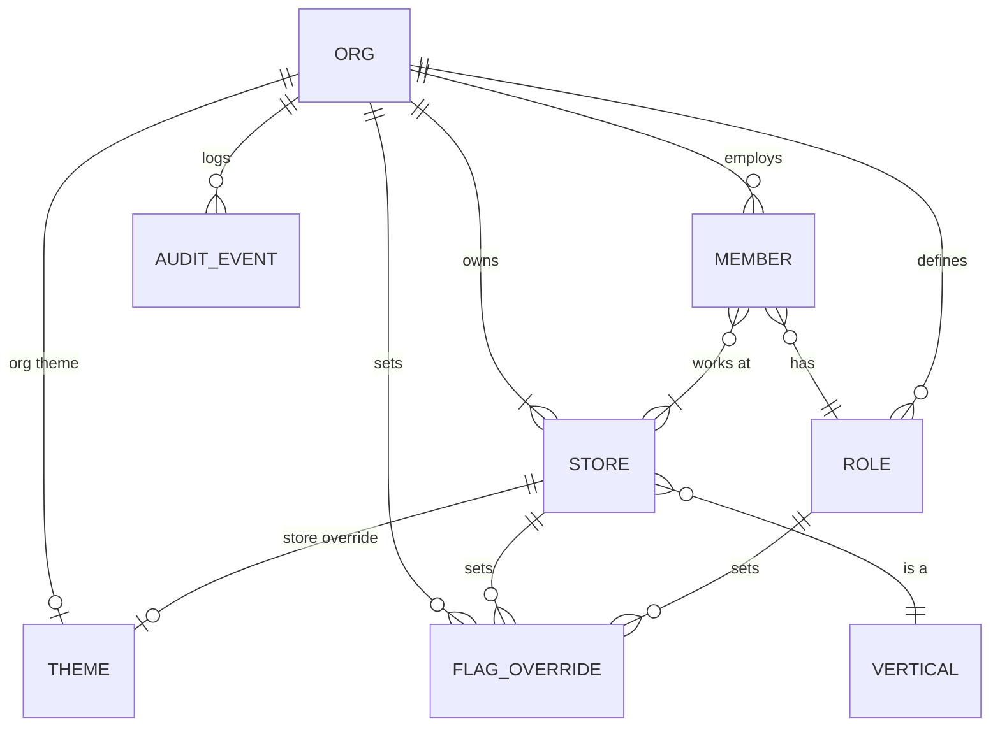

# 10 — Admin & Multi-tenancy

## Tenancy model

- **Org** = business account (one owner, many stores). **Store** has one vertical. One org can mix verticals: a parlour and a fancy store under one owner.
- Firestore paths: `orgs/{orgId}`, `orgs/{orgId}/stores/{storeId}`, `.../members`, `.../roles`, `.../flags`, `.../audit`.
- Custom auth claims: `orgId`, `role`, `storeIds`. The local DB file is per org.

## Admin section (in-app, Owner / Org admin only)
Entry is More → Admin. Screens 41–48 in `/designs`.

| Screen | What admin does | Notes |
|--------|-----------------|-------|
| Admin home | See stores, staff count, features on, last sync | Shortcuts to all below |
| Stores | Add store, choose vertical, GST, invoice prefix, printer | Changing the vertical needs confirmation (affects catalog fields) |
| Staff & roles | Invite, assign role and stores, deactivate | Deactivation revokes the token via Cloud Function |
| Permissions | Edit role × action matrix | Built-in roles cannot drop below safe minimums |
| Theme | Org accent, per-store override, **lock for staff**, logo on receipts | Staff keep Light/Dark choice |
| Features | Toggle flags per org / store / role | App-level locks shown read-only |
| Audit log | Filter by bills, cash, settings, staff | Append-only, 1-year retention |
| Invite | Name, phone, role, stores → SMS link | Link expires in 72 h |

## Default permission matrix

| Action | Owner | Manager | Cashier | Stylist |
|--------|:-----:|:-------:|:-------:|:-------:|
| Create bill | ✓ | ✓ | ✓ | ✓ |
| Discount above limit | ✓ | ✓ | — | — |
| Cancel bill | ✓ | ✓ | — | — |
| Returns | ✓ | ✓ | ✓ | — |
| Credit sales | ✓ | ✓ | — | — |
| Cash out | ✓ | ✓ | ✓ | — |
| Day close / reopen | ✓ / ✓ | ✓ / — | — | — |
| Edit inventory | ✓ | ✓ | — | — |
| View insights | ✓ | ✓ (own store) | — | own stats |
| Admin section | ✓ | — | — | — |

Permissions are enforced in three places: UI (hide), view model (guard), Firestore rules (authoritative).

## Super admin (Apoorva team)
Not in the shop app. It uses the Firebase console plus a small internal tool later. It manages app-level flags, the vertical catalogue (new verticals such as handloom), plan limits, and support impersonation (read-only, audited).

## Audit events
`{id, orgId, storeId, actorId, action, target, before, after, at, deviceId}`. Written locally first, then synced. Members cannot edit them (rules deny update/delete).
